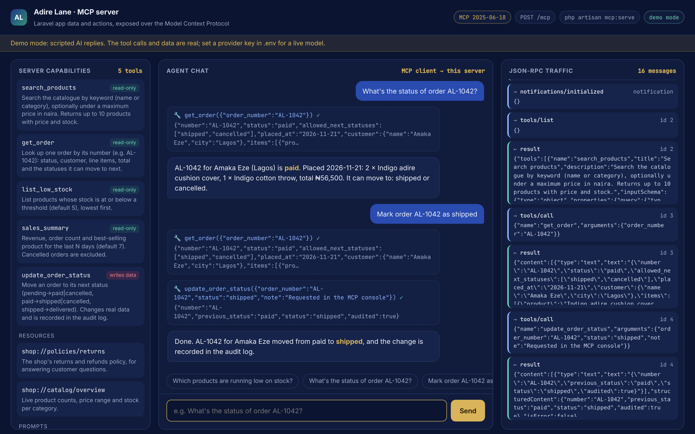

# 🔌 Laravel MCP Server

> **Day 13 of [30 Days of AI Agents](https://github.com/obiokoye)**: a Laravel 11 app that exposes its data and actions over the Model Context Protocol (MCP), so Claude Desktop, Cursor or any MCP client can discover its tools and call them safely.




The demo app is **Adire Lane**, a fictional Lagos homeware shop with products, customers and orders in SQLite. The MCP server turns it into:

| MCP primitive | What this app exposes |
|---------------|-----------------------|
| **Tools**     | `search_products`, `get_order`, `list_low_stock`, `sales_summary` (read-only) and `update_order_status` (writes data) |
| **Resources** | `shop://policies/returns` (markdown), `shop://catalog/overview` (live JSON) |
| **Prompts**   | `draft_customer_reply` (order number + customer question) |

```text
→ {"jsonrpc":"2.0","id":3,"method":"tools/call","params":{"name":"get_order","arguments":{"order_number":"AL-1042"}}}
← {"number":"AL-1042","status":"paid","allowed_next_statuses":["shipped","cancelled"],"total_naira":56500, ...}
→ {"jsonrpc":"2.0","id":4,"method":"tools/call","params":{"name":"update_order_status","arguments":{"order_number":"AL-1042","status":"shipped"}}}
← {"number":"AL-1042","previous_status":"paid","status":"shipped","audited":true}
```

## What it shows

- **The MCP protocol from scratch**: JSON-RPC 2.0 with `initialize` version negotiation, `tools/list`, `tools/call`, `resources/list|read`, `prompts/list|get`, `ping` and notifications. No MCP SDK, so every line is readable.
- **Two transports, one server**: Streamable HTTP (`POST /mcp`, JSON responses) for remote clients, and stdio (`php artisan mcp:serve`) for Claude Desktop and Cursor. Both call the same `McpServer`.
- **Tool design for agents**: JSON Schemas the model reads, Laravel validation rules we enforce, `readOnlyHint`/`destructiveHint` annotations, and structured results (`structuredContent`).
- **Errors the model can recover from**: bad arguments or an illegal status change come back as an `isError` tool result with a plain message, not a crash, so the model can correct itself.
- **Guardrails in code, not in the prompt**: write tools are hidden unless `MCP_ALLOW_WRITES=true`, status changes follow `Order::TRANSITIONS`, every change is written to an `order_events` audit table, and the customer's email never leaves the server.
- **Transport security**: optional bearer token (`MCP_TOKEN`, constant-time compare), an `Origin` check against DNS rebinding, and rate limiting.
- **An agent that is a real MCP client**: the built-in console's agent (Prism PHP) never touches Eloquent. It discovers the tools over MCP and calls them over MCP, and the UI shows every JSON-RPC message.
- **Tests without API keys**: 26 PHPUnit tests with in-memory SQLite and a scripted LLM, run on every push.

## Quick start

Needs PHP 8.2+ (with `pdo_sqlite` and `fileinfo`) and Composer.

```bash
git clone https://github.com/obiokoye/laravel-mcp-server.git
cd laravel-mcp-server
composer install
cp .env.example .env
php artisan key:generate
touch database/database.sqlite
php artisan migrate --seed
php artisan serve
```

Open http://localhost:8000 and click one of the suggested questions.

For a live model, paste a free Gemini key from https://aistudio.google.com/apikey into `GEMINI_API_KEY=` in `.env` (and keep `DEMO_MODE=false`).

### Windows

Use [Laravel Herd](https://herd.laravel.com/windows) (includes PHP and Composer) or your existing WAMP PHP 8.2+. In Command Prompt:

```bat
git clone https://github.com/obiokoye/laravel-mcp-server.git
cd laravel-mcp-server
composer install
copy .env.example .env
php artisan key:generate
type nul > database\database.sqlite
php artisan migrate --seed
php artisan serve
```

If you see `could not find driver`, enable `extension=pdo_sqlite` (and `extension=fileinfo`) in your `php.ini`, then run the migrate step again.

To reset the demo data at any time: `php artisan migrate:fresh --seed`.

## Demo mode

With `DEMO_MODE=true`, or automatically when the selected provider has no key, the console shows **"Demo mode: scripted AI replies"**. A scripted LLM (`app/Agent/ScriptedLlmClient.php`, the same one the tests use) makes the tool calls a real model would make and writes its reply from the real results. The MCP traffic, validation, database reads and writes are all real.

The MCP server itself never needs an API key: Claude Desktop, Cursor or the MCP Inspector bring their own model.

## Connect an MCP client

**Claude Desktop / Cursor (stdio)**: add this to the client's MCP config (`claude_desktop_config.json` or `.cursor/mcp.json`) with your own path:

```json
{
  "mcpServers": {
    "adire-lane": {
      "command": "php",
      "args": ["/full/path/to/laravel-mcp-server/artisan", "mcp:serve"]
    }
  }
}
```

On Windows use a path like `"C:\\Users\\you\\laravel-mcp-server\\artisan"`.

**HTTP**: run `php artisan serve` and point a client at `http://localhost:8000/mcp`, for example the [MCP Inspector](https://github.com/modelcontextprotocol/inspector) (`npx @modelcontextprotocol/inspector`, transport "Streamable HTTP"). Or with curl:

```bash
curl -s http://localhost:8000/mcp -H "Content-Type: application/json" \
  -d '{"jsonrpc":"2.0","id":1,"method":"tools/call","params":{"name":"list_low_stock","arguments":{"threshold":3}}}'
```

If you set `MCP_TOKEN`, send it as `Authorization: Bearer <token>`.

## Configuration

| Variable           | Default | What it does |
|--------------------|---------|--------------|
| `MCP_TOKEN`        | empty   | Bearer token required on `POST /mcp` when set |
| `MCP_ALLOW_WRITES` | `false` (`true` in `.env.example`) | Expose `update_order_status` |
| `DEMO_MODE`        | `false` | Scripted replies in the console, no key needed |
| `LLM_PROVIDER`     | `gemini`| Model for the console's agent |

| `LLM_PROVIDER` | Key variable        | Default model             | Free tier |
|----------------|---------------------|---------------------------|-----------|
| `gemini`       | `GEMINI_API_KEY`    | `gemini-2.5-flash`        | ✅ |
| `groq`         | `GROQ_API_KEY`      | `llama-3.3-70b-versatile` | ✅ |
| `openai`       | `OPENAI_API_KEY`    | `gpt-4o-mini`             | ❌ |
| `anthropic`    | `ANTHROPIC_API_KEY` | `claude-haiku-4-5`        | ❌ |

Override the model with `LLM_MODEL=...`. Providers are called through [Prism PHP](https://github.com/prism-php/prism).

## Project structure

```text
app/
  Mcp/
    McpServer.php          # JSON-RPC dispatcher: initialize, tools/*, resources/*, prompts/*
    StdioTransport.php     # newline-delimited JSON on stdin/stdout
    Contracts/             # Tool, Resource, Prompt interfaces
    Tools/                 # SearchProducts, GetOrder, LowStock, SalesSummary, UpdateOrderStatus
    Resources/             # ReturnsPolicy, CatalogOverview
    Prompts/               # DraftCustomerReply
  Agent/
    McpClient.php          # in-process MCP client that records the traffic
    McpAgent.php           # discovers tools over MCP, then lets the LLM call them
    PrismLlmClient.php     # real model via Prism PHP (MCP schema -> Prism tool)
    ScriptedLlmClient.php  # demo mode + tests
  Http/Controllers/        # McpController (POST /mcp), ConsoleController (web UI)
  Http/Middleware/AuthenticateMcp.php  # bearer token + Origin check
  Console/Commands/McpServe.php        # php artisan mcp:serve
config/mcp.php             # which tools/resources/prompts are registered
resources/views/console.blade.php      # the console UI
tests/Feature/             # protocol, stdio and agent tests (no network)
```

## Adding a tool

1. Create a class in `app/Mcp/Tools/` that implements `App\Mcp\Contracts\Tool` (name, description, JSON Schema, validation rules, `isReadOnly()`, `handle()`).
2. Add it to the `tools` array in `config/mcp.php`.

Every MCP client, and the console agent, will see it on the next `tools/list`.

This server is hand-written on purpose, to learn the protocol. For production, Laravel also has an official `laravel/mcp` package worth comparing.

## Run tests

```bash
php artisan test
```

New to MCP? See **[LEARN.md](LEARN.md)**, which explains the protocol and this codebase in Laravel terms.

---

MIT © Nicholas Okoye
